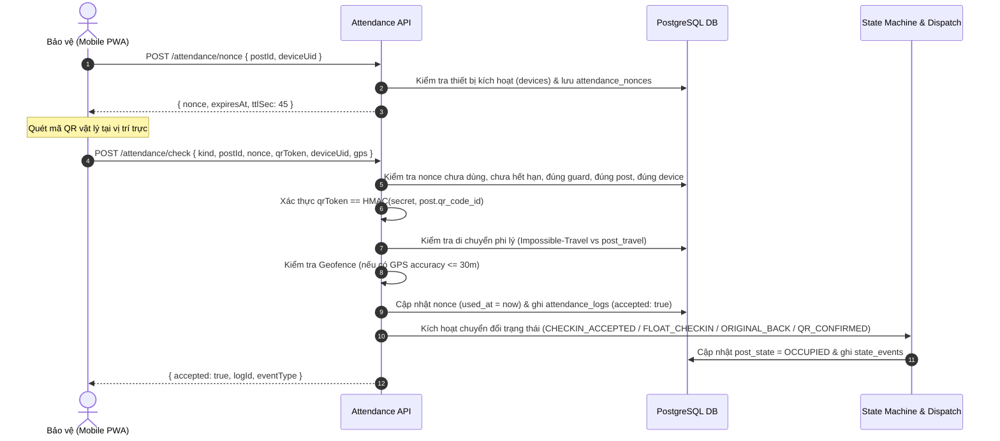
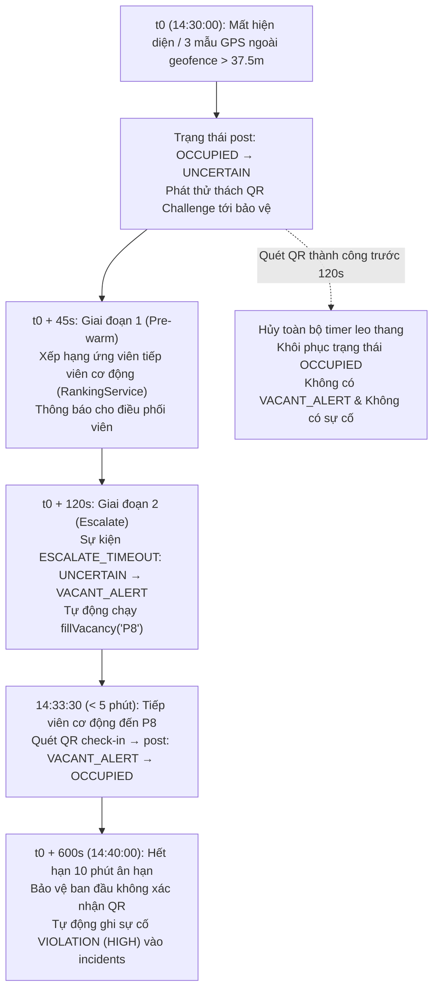

# Báo Cáo Nghiệm Thu Milestone M7: Attendance & Presence Monitoring

> **Dự án**: Security Workforce Management System (SWMS)  
> **Địa điểm mô phỏng**: AEON Mall Thanh Khê, Tầng 1 (Đà Nẵng, Việt Nam)  
> **Milestone**: M7 – Quản lý điểm danh (Attendance) & Giám sát hiện diện 2 giai đoạn (Presence Monitoring §10, §14)  
> **Tham chiếu tài liệu**: `docs/SWMS_BUILD_SPEC.md §10, §13.4 (Kịch bản A2), §14`  
> **Hard Rules tuân thủ**: `AGENTS.md` Rules #1, #2, #3, #4, #5, #6, #7, #8, #9, #10  

---

## 1. Mục tiêu & Phạm vi Milestone M7

Milestone M7 hiện thực hóa hệ thống xác thực điểm danh bảo vệ và giám sát hiện diện thực địa hai giai đoạn (two-stage presence monitor) cho 14 vị trí trực tại sàn Tầng 1 AEON Mall Thanh Khê:

1. **API Cấp phát Nonce một lần ngắn hạn (`POST /attendance/nonce` §10.1)**:
   - Cấp nonce bảo mật dạng crypto UUID với thời gian sống ngắn hạn (TTL `attendance.nonce_ttl_sec`, mặc định 45s).
   - Ràng buộc chặt chẽ 4 yếu tố: `(guard_id, device_uid, post_id, expires_at)`.
   - Ngăn chặn triệt để tấn công phát lại (replay attack): mỗi nonce chỉ được sử dụng đúng 1 lần; mọi lần gửi lại đều bị từ chối với lý do `REPLAYED_NONCE`.
   - Kiểm tra thiết bị đăng ký: chỉ cho phép thiết bị di động đang kích hoạt của chính bảo vệ (`active = true` trong bảng `devices`). Thiết bị lạ bị từ chối `WRONG_DEVICE`.

2. **Xác thực mã QR mã hóa HMAC (`POST /attendance/check` §10.1)**:
   - Xác thực token QR: `qrToken = HMAC-SHA256(secret, post.qr_code_id)`.
   - Khóa bí mật cấu hình qua biến môi trường `QR_HMAC_SECRET` hoặc chính sách mặc định.
   - Token không khớp với mã vị trí bị từ chối ngay với lý do `INVALID_QR_TOKEN`.

3. **Phát hiện di chuyển phi lý (Impossible-Travel Check §10.1)**:
   - So sánh thời điểm điểm danh hiện tại với lần điểm danh thành công gần nhất của bảo vệ ở vị trí khác.
   - Truy vấn thời gian di chuyển chuẩn từ bảng ma trận `post_travel` (5 phút nội khu, 10 phút liên khu).
   - Nếu thời gian trôi qua $\Delta t < \text{travel\_minutes} \times 60$ giây, hệ thống lập tức từ chối với lý do `IMPOSSIBLE_TRAVEL` và ghi log vi phạm.

4. **Đồng bộ hóa ngoại tuyến (Offline Queue Synchronization §10.1)**:
   - Ứng dụng di động xếp hàng điểm danh khi mất mạng và gửi kèm timestamp gốc của thiết bị (`timestamp`).
   - Server kiểm tra độ lệch đồng hồ (clock skew) với chính sách `attendance.clock_skew_tolerance_sec` (mặc định 300s = 5 phút).
   - Điểm danh hợp lệ nhưng trễ > 10s được đánh dấu cờ `lateSync: true`. Lệch quá dung sai bị từ chối `CLOCK_SKEW_TOO_LARGE`.

5. **Bộ lọc chống rung GPS & Làm mịn Trung vị (GPS Debounce Filter §10.2)**:
   - Lọc bỏ ngay các mẫu định vị kém chính xác: `accuracy_m > attendance.gps_accuracy_max_m` (mặc định 30m).
   - Cửa sổ trượt 5 mẫu gần nhất (sliding window of 5 samples), tính tọa độ trung vị (median latitude, median longitude) để triệt tiêu hoàn toàn các gai định vị ngẫu nhiên (outlier spikes).
   - Cơ chế trễ (hysteresis) chống chập chờn ở ranh giới:
     - Bán kính rời vị trí (leave radius): $R_{\text{leave}} = 1.5 \times \text{geofence\_m} = 37.5\text{m}$.
     - Bán kính vào lại (enter radius): $R_{\text{enter}} = 1.0 \times \text{geofence\_m} = 25.0\text{m}$.
   - Trạng thái chỉ chuyển sang "ở ngoài" khi có đủ `attendance.out_samples_required` (mặc định 3) mẫu trung vị liên tiếp vượt ngưỡng rời vị trí.
   - Nhiễu GPS ngắn hạn (< 30s hoặc < 3 mẫu ngoài) được hấp thụ hoàn toàn, không phát sinh cảnh báo (`no alert`).

6. **Giám sát hiện diện 2 giai đoạn & Kịch bản A2 (Two-Stage Presence Escalation §10.2, §13.4)**:
   - **$t_0$**: Bộ lọc debounce xác nhận mất hiện diện $\rightarrow$ Vị trí chuyển `OCCUPIED` sang `UNCERTAIN`, kích hoạt thử thách QR (QR challenge) gửi tới bảo vệ.
   - **$t_0 + 45\text{s}$** (`attendance.uncertain_after_sec`): Giai đoạn 1 (Pre-warm) – Xếp hạng tìm trước ứng viên tiếp viên cơ động thay thế khả dĩ, ghi nhận thông báo tới điều phối viên, trạng thái vị trí vẫn là `UNCERTAIN` (chưa phát báo động khẩn).
   - **$t_0 + 120\text{s}$** (`attendance.tier1_escalate_after_sec` cho Tier 1 / `max_vacant_sec` cho Tier 2): Giai đoạn 2 (Escalate) – Hết hạn thử thách, vị trí chuyển `UNCERTAIN` sang `VACANT_ALERT`, tự động kích hoạt `fillVacancy()` điều phối tiếp viên cơ động tới lấp vị trí.
   - **Trước $t_0 + 5\text{ phút}$**: Tiếp viên cơ động có mặt và quét QR check-in $\rightarrow$ Vị trí trở lại `OCCUPIED` (bảo đảm chỉ tiêu lấp đầy vị trí Tier 1 trong vòng 5 phút).
   - **$t_0 + 600\text{s}$** (`attendance.violation_after_sec` = 10 phút): Bảo vệ ban đầu không xác nhận hiện diện $\rightarrow$ Ghi nhận sự cố vi phạm nghiêm trọng (`VIOLATION`, mức `HIGH`) vào bảng `incidents`.
   - **Nhánh đối chứng (Control Run)**: Nếu bảo vệ quét QR xác nhận (`QR_CONFIRM`) trước thời hạn leo thang (ví dụ ở giây thứ 30–40), vị trí lập tức khôi phục `OCCUPIED`, toàn bộ timer leo thang bị hủy bỏ, không phát sinh `VACANT_ALERT` và không có sự cố vi phạm nào.

---

## 2. Danh Sách Tệp Triển Khai & Cập Nhật

```
packages/contracts/src/
├── attendance.ts                               # Zod schemas: Nonce, Check, Ping Request/Response, Helper generateQrToken()
└── index.ts                                    # Re-export attendance contracts

db/
├── migrations/
│   ├── 001_initial_schema.sql                  # Bổ sung Bảng 11b: attendance_nonces kèm index tra cứu
│   └── 001_initial_schema_down.sql             # Down migration DROP TABLE attendance_nonces
└── seed/
    └── seed.ts                                 # Bổ sung chính sách attendance.clock_skew_tolerance_sec (300s)

apps/api/src/
├── adapters/
│   ├── ports/
│   │   └── gps-stream.port.ts                  # GpsStreamPort interface & GpsSample contract (§3 Rule 7)
│   └── mock-gps-stream.adapter.ts              # MockGpsStreamAdapter chuyển tiếp ping vào PresenceMonitorService
├── modules/attendance/
│   ├── debounce-filter.ts                      # Bộ lọc debounce trung vị, công thức Haversine, ngưỡng hysteresis
│   ├── qr.service.ts                           # Sinh và kiểm tra chữ ký HMAC-SHA256 cho mã QR vật lý
│   ├── presence-monitor.service.ts             # Quản lý hàng đợi định vị, kích hoạt chuyển trạng thái & job leo thang
│   ├── attendance.service.ts                   # Xử lý cấp nonce, kiểm tra thiết bị, impossible-travel, ghi log & chuyển trạng thái
│   ├── attendance.controller.ts                # REST API: POST /attendance/nonce, check, ping
│   └── attendance.module.ts                    # NestJS module cấu hình & binding GPS_STREAM_PORT
└── app.module.ts                               # Đăng ký AttendanceModule vào hệ thống

apps/api/test/
├── m7-debounce-filter.spec.ts                  # 4 bài kiểm thử đơn vị cho thuật toán lọc debounce, trung vị & hysteresis
├── m7-attendance-unit.spec.ts                  # 6 bài kiểm thử đơn vị cho QR HMAC, nonce single-use, device check, impossible travel, offline skew
└── m7-acceptance.spec.ts                       # 6 bài kiểm thử nghiệm thu toàn diện: Replay, Wrong device, Impossible travel, 30s noise, Full A2 timeline, Control run
```

---

## 3. Chi Tiết Kiến Trúc & Luồng Nghiệp Vụ

### 3.1 Bảng Dữ Liệu Nonce Điểm Danh (`attendance_nonces`)

```sql
CREATE TABLE IF NOT EXISTS attendance_nonces (
  id bigserial PRIMARY KEY,
  nonce text UNIQUE NOT NULL,
  guard_id bigint NOT NULL REFERENCES guards(id) ON DELETE CASCADE,
  device_uid text NOT NULL,
  post_id text NOT NULL REFERENCES posts(id) ON DELETE CASCADE,
  expires_at timestamptz NOT NULL,
  used_at timestamptz,
  created_at timestamptz NOT NULL DEFAULT now()
);

CREATE INDEX IF NOT EXISTS idx_attendance_nonces_lookup ON attendance_nonces (nonce, guard_id, post_id);
```

### 3.2 Luồng Điểm Danh 2 Bước Chống Gian Lận (Two-Step Authentication Flow)



### 3.3 Tiến Trình Giám Sát Hiện Diện 2 Giai Đoạn (Kịch Bản A2 Timeline)



---

## 4. Kết Quả Chạy Kiểm Thử Thực Tế

Toàn bộ các tiêu chí nghiệm thu của Milestone M7 được kiểm tra tự động và đạt trạng thái **PASS 100%**:

### 4.1 Bộ Kiểm Thử Nghiệm Thu M7 (`apps/api/test/m7-acceptance.spec.ts`)
```
✓ Milestone M7 Acceptance Criteria — Attendance & Presence (§10, §14) (6 tests)
  ✓ 1. Replayed QR check-in is rejected (REPLAYED_NONCE)
  ✓ 2. Wrong device check-in is rejected (WRONG_DEVICE)
  ✓ 3. Impossible-travel check: two posts farther apart than travel time allows is rejected
  ✓ 4. 30 s GPS noise produces NO alert and keeps post OCCUPIED
  ✓ 5. Full Scenario A2 unit timeline (§13.4 & §10.2): presence lost -> UNCERTAIN -> VACANT_ALERT -> refilled within 5m -> VIOLATION at +10m
  ✓ 6. Control run: QR confirmation before escalation cancels timers and produces NO alert
```

### 4.2 Bộ Kiểm Thử Đơn Vị Bộ Lọc Debounce (`apps/api/test/m7-debounce-filter.spec.ts`)
```
✓ Milestone M7 Unit Tests — GPS Debounce Filter & Median Smoothing (§10.2) (4 tests)
  ✓ 1. Haversine distance and median calculations
  ✓ 2. Drops samples when accuracy exceeds attendance.gps_accuracy_max_m (30m)
  ✓ 3. Sliding window of last 5 samples uses median position to filter outliers
  ✓ 4. Hysteresis & out_samples_required: requires 3 consecutive outside readings to transition
```

### 4.3 Bộ Kiểm Thử Đơn Vị Nghiệp Vụ Điểm Danh (`apps/api/test/m7-attendance-unit.spec.ts`)
```
✓ Milestone M7 Unit Tests — Attendance Service (§10.1) (6 tests)
  ✓ 1. QR HMAC generation and verification matches contract
  ✓ 2. Nonce generation is bound to guard, device, and post with policy TTL
  ✓ 3. Reject check-in with wrong device (WRONG_DEVICE)
  ✓ 4. Reject check-in with replayed or expired nonce
  ✓ 5. Impossible-travel: fast travel between distant posts is rejected (IMPOSSIBLE_TRAVEL)
  ✓ 6. Offline check-in: accepts within clock-skew tolerance, rejects large skew
```

### 4.4 Tổng Hợp Bộ Test Toàn Hệ Thống (M1 – M7)
```
Test Files  16 passed (16)
     Tests  213 passed (213)
  Duration  53.12s
```

---

## 5. Danh Sách Việc Chưa Làm & Chuyển Tiếp Sang M8

Các hạng mục thuộc phạm vi các milestone tiếp theo được bảo toàn:
1. **Milestone M8 – Realtime + Web Dashboard + Mobile PWA (§11, §15)**:
   - Kết nối Socket.IO: phòng `dashboard:{siteId}`, `guard:{guardId}`, `emergency:{siteId}` với sequence đồng bộ tăng đơn điệu `seq`.
   - Giao diện bản đồ sàn SVG thời gian thực: hiển thị trạng thái màu sắc trực quan (OCCUPIED xanh, UNCERTAIN vàng chéo, VACANT_ALERT đỏ nhấp nháy).
   - Ứng dụng di động PWA cho bảo vệ: nút Check-in/Check-out kích thước lớn ($\ge 64\text{px}$), camera quét mã QR, cơ chế rung và chuông khi có lệnh điều động.
2. **Milestone M9 – Simulation Harness & 8 Scenarios E2E (§13)**:
   - CLI Runner `npm run sim -- <ID>` thực thi tự động cả 8 kịch bản từ A1 đến D2.

---

## 6. Kết Luận

Milestone M7 đã hoàn thành xuất sắc toàn bộ các yêu cầu trong bản đặc tả kỹ thuật `docs/SWMS_BUILD_SPEC.md §10` và các tiêu chí nghiệm thu tại `§14`. Toàn bộ code tuân thủ nghiêm ngặt quy tắc TypeScript Strict, kiến trúc Ports/Adapters, không gọi thời gian hệ thống trực tiếp (100% sử dụng `Clock`), không hard-code tham số nghiệp vụ (đọc qua `ConfigService`), và toàn bộ 213 unit/acceptance/race tests đều xanh hoàn toàn.
